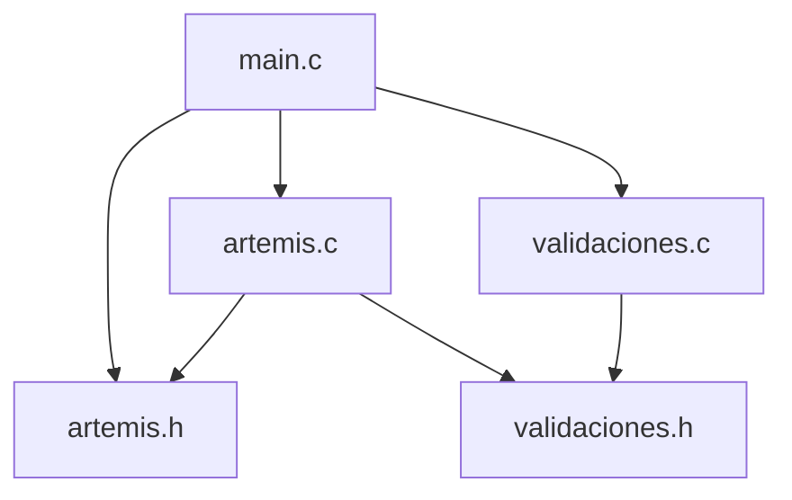

# Simulador Artemis - Insercion y Estabilidad en Orbita Terrestre Baja (LEO)

Trabajo Practico Integrador Final de **Algoritmos y Estructuras de Datos**  
Universidad Tecnologica Nacional - Facultad Regional Resistencia  
Ingenieria en Sistemas de Informacion

## 1. Integrantes y comision

> Completar antes de la entrega.

| Nombre y apellido | Legajo | Usuario de GitHub |
|---|---|---|
| Nombre 1 | Legajo 1 | usuario1 |
| Nombre 2 | Legajo 2 | usuario2 |
| Nombre 3 | Legajo 3 | usuario3 |
| Nombre 4 | Legajo 4 | usuario4 |
| Nombre 5 | Legajo 5 | usuario5 |

**Comision:** completar.

**Repositorio:** https://github.com/Adan4321/laboratorio_c

## 2. Escenario Artemis asignado

**Situacion - Problema 2: Insercion y Estabilidad en Orbita Terrestre Baja - LEO (MCU y Gravitacion).**

La nave Orion se encuentra en una orbita circular baja de estacionamiento alrededor de la Tierra. El programa modela el movimiento circular uniforme (MCU) de la nave y la accion de la fuerza gravitatoria como fuerza centripeta.

### Datos fisicos utilizados

| Constante | Valor |
|---|---|
| Constante de gravitacion universal (`G`) | `6.674e-11 N·m²/kg²` |
| Masa de la Tierra (`M_T`) | `5.972e24 kg` |
| Radio medio de la Tierra (`R_T`) | `6.371.000 m` |
| Altitud orbital por defecto (`h`) | `192.000 m` (192 km) |
| Masa de Orion por defecto (`m`) | `33.000 kg` |

### Modelo fisico

- Radio orbital: `r = R_T + h`
- Velocidad orbital: `v = sqrt(G·M_T / r)`
- Periodo orbital: `T = 2π·r / v`
- Aceleracion centripeta: `a_c = v² / r = G·M_T / r²`
- Fuerza gravitatoria: `F_g = m·a_c`
- Pulso lateral: `v_lat = a·Δt`, `desvio = ½·a·Δt²`

### Preguntas del escenario que responde el simulador

1. Demostracion de que la fuerza gravitatoria actua como fuerza centripeta y calculo de la velocidad orbital.
2. Periodo orbital en segundos y minutos.
3. Aceleracion centripeta experimentada por los astronautas.
4. Efecto de un pulso lateral perpendicular a la velocidad orbital: velocidad lateral y desvio instantaneo.
5. Datos complementarios: frecuencia orbital, velocidad angular, vueltas diarias, velocidad de escape y fuerza gravitatoria.

### Valores de referencia

Para `h = 192 km` y `m = 33.000 kg`:

| Magnitud | Valor aproximado |
|---|---|
| Radio orbital | `6.563.000 m` |
| Velocidad orbital | `7.792,95 m/s` |
| Periodo orbital | `5.291,52 s` (`88,19 min`) |
| Aceleracion centripeta | `9,2534 m/s²` |
| Fuerza gravitatoria | `305.362,10 N` |
| Pulso `a = 0,50 m/s²`, `Δt = 10 s` | `v_lat = 5,00 m/s`; desvio `25,00 m` |

## 3. Reglas de la simulacion

- La mision inicia con los valores por defecto del escenario: `h = 192 km` y `m = 33.000 kg`.
- El usuario puede configurar una nueva altitud (`160 a 2000 km`) y masa (`1000 a 100000 kg`).
- Cada calculo realizado se registra en un arreglo de resultados y luego se muestra en el reporte.
- Cada avance de orbita representa un **turno de simulacion**. Se puede avanzar de `1` a `1000` orbitas por turno.
- La simulacion acumula tiempo de mision, orbitas completadas, distancia recorrida y pulsos laterales aplicados.
- El reporte final incluye los calculos, el resumen de desempeno y la bitacora de eventos.
- La opcion de reinicio vuelve a los valores por defecto y borra el reporte acumulado.

## 4. Arquitectura del programa

| Archivo | Responsabilidad |
|---|---|
| `main.c` | Funcion `main`, menu principal e inicializacion del flujo |
| `artemis.h` | Constantes, tipos de datos (`Mision`, `Resultado`, `Evento`) y prototipos |
| `artemis.c` | Fisica LEO, calculos, simulacion por turnos, reporte y bitacora |
| `validaciones.h` | Prototipos de las funciones de entrada segura |
| `validaciones.c` | Lectura validada de enteros, doubles y confirmaciones `s/n` |
| `Makefile` | Compilacion multiplataforma (Linux/macOS/Windows) |
| `compilar.bat` | Compilacion en Windows sin depender de `make` |
| `ejecutar.bat` | Ejecucion en Windows |
| `limpiar.bat` | Limpieza de objetos y ejecutable en Windows |
| `compilar_y_ejecutar.bat` | Compilacion y ejecucion en un solo paso en Windows |



### Uso de estructuras y punteros

- `Mision` guarda el estado completo de la simulacion.
- `Resultado` guarda cada calculo registrado.
- `Evento` guarda la bitacora de la mision.
- Las funciones reciben punteros (`Mision *`, `Resultado *`, `int *`) para modificar el estado original sin realizar copias.
- Se utiliza el arreglo `Resultado resultados[MAX_RESULTADOS]` junto con el contador `n_resultados`.

## 5. Compilacion y ejecucion

### Requisitos

- **Linux/macOS:** `gcc` y, opcionalmente, `make`.
- **Windows:** MinGW-w64 con `gcc` agregado al `PATH`. `make` es opcional porque se incluyen scripts `.bat`.

Verificar que el compilador este disponible:

```bash
gcc --version
```

### Linux / macOS

Con Makefile:

```bash
make
./simulador_artemis
```

Para compilar y ejecutar en un solo paso:

```bash
make run
```

Para limpiar los archivos generados:

```bash
make clean
```

Compilacion directa:

```bash
gcc -std=c11 -Wall -Wextra -Wpedantic main.c artemis.c validaciones.c -o simulador_artemis -lm
./simulador_artemis
```

### Windows

El codigo detecta Windows automaticamente y habilita la consola UTF-8. El Makefile tambien detecta Windows y genera `simulador_artemis.exe`.

#### Opcion A: scripts incluidos (recomendada)

```bat
compilar.bat
ejecutar.bat
```

Para compilar y ejecutar en un solo paso:

```bat
compilar_y_ejecutar.bat
```

Para limpiar los archivos generados:

```bat
limpiar.bat
```

#### Opcion B: con Make para Windows

Si tiene `mingw32-make` o `make` disponible:

```bat
mingw32-make
mingw32-make run
mingw32-make clean
```

#### Opcion C: compilacion directa con MinGW

```bat
gcc -std=c11 -Wall -Wextra -Wpedantic main.c artemis.c validaciones.c -o simulador_artemis.exe -lm
simulador_artemis.exe
```

### Tarea de VS Code

El archivo `.vscode/tasks.json` adapta las tareas segun el sistema operativo:

- **Linux/macOS:** ejecuta `make`, `./simulador_artemis` y `make clean`.
- **Windows:** ejecuta `compilar.bat`, `ejecutar.bat` y `limpiar.bat` mediante `cmd`.

### Portabilidad

- El codigo fuente es C11 portable y no usa APIs exclusivas de un sistema operativo.
- `windows.h` y `SetConsoleOutputCP(CP_UTF8)` se incluyen solo cuando se compila en Windows (`_WIN32`).
- Las lecturas numericas aceptan coma o punto decimal sin depender del locale del sistema.
- Los archivos `.bat` se entregan con terminaciones de linea CRLF para Windows.

## 6. Menu del programa

```text
1) Configurar mision (altitud y masa)
2) Calcular velocidad orbital
3) Calcular periodo orbital
4) Calcular aceleracion centripeta y fuerza gravitatoria
5) Simular pulso lateral
6) Avanzar orbita (turno de simulacion)
7) Ver reporte de la mision
8) Ver analisis teorico
9) Reiniciar simulacion
0) Salir
```

## 7. Validaciones implementadas

- Lectura de lineas completas con `fgets`.
- Conversion estricta con `strtod` y `strtol`, verificando que no queden caracteres invalidos.
- Se acepta coma o punto como separador decimal, sin depender del locale del sistema.
- Rechazo de texto, entradas vacias, valores negativos fuera de rango y notacion no numerica.
- Rechazo de `NaN`, infinitos y desbordamientos (`ERANGE`).
- Control de entradas demasiado largas.
- Validacion de rangos:
  - Altitud: `160 a 2000 km`.
  - Masa: `1.000 a 100.000 kg`.
  - Aceleracion del pulso: `0,1 a 5,0 m/s²`.
  - Duracion del pulso: `1 a 60 s`.
  - Orbitas por turno: `1 a 1000`.
- Confirmaciones `s/n` validadas.
- Manejo de fin de entrada (`EOF`) sin bucles infinitos.
- Pausa entre acciones para mantener la interfaz legible.

## 8. Registro del uso de Inteligencia Artificial

| Herramienta | Modelo | Tareas realizadas |
|---|---|---|
| opencode | `deepseek-v4.1-flash-free` | Analisis del repositorio, correccion de errores de compilacion, diseno modular, implementacion de la fisica del Problema 2, validaciones, reporte, Makefile, scripts de Windows y documentacion |

### Prompts o consultas representativas

1. "Vamos a trabajar con este repo https://github.com/Adan4321/laboratorio_c.git"
2. "Verifica que cumple con los requisitos" (contrastando el proyecto con la consigna del TPI).
3. "Ok ahora si, haz todo eso que dijimos" (implementacion de los modulos pendientes).
4. "Dejalo full preparado para Windows" (Makefile condicional, scripts `.bat` y tareas de VS Code por sistema operativo).

### Como se valido y adapto el codigo generado

- Se compilo con `gcc -std=c11 -Wall -Wextra -Wpedantic` sin errores ni advertencias.
- Se ejecutaron casos de prueba con entradas validas e invalidas: texto, valores fuera de rango, lineas vacias, entradas largas y confirmaciones incorrectas.
- Se verificaron los resultados fisicos contra los valores de referencia del escenario (`h = 192 km`, `m = 33.000 kg`).
- Se reviso que la arquitectura respete la separacion en modulos `.c` y `.h`.
- El codigo se preparo para compilar en Linux y Windows, usando `windows.h` solo de forma condicional para la salida UTF-8 en Windows.
- No se utilizo IA para generar voces, avatares ni la participacion de los integrantes en el video.

> Importante: todos los integrantes deben comprender y poder defender tecnicamente cada linea del codigo durante el coloquio.

## 9. Entregables

- Codigo fuente modularizado: `main.c`, `artemis.c`, `artemis.h`, `validaciones.c`, `validaciones.h`.
- `Makefile`, scripts `.bat` para Windows y tareas de compilacion de VS Code.
- `README.md` con la descripcion del escenario, instrucciones y registro de IA.
- Video de presentacion del equipo (pendiente de grabacion y carga).
