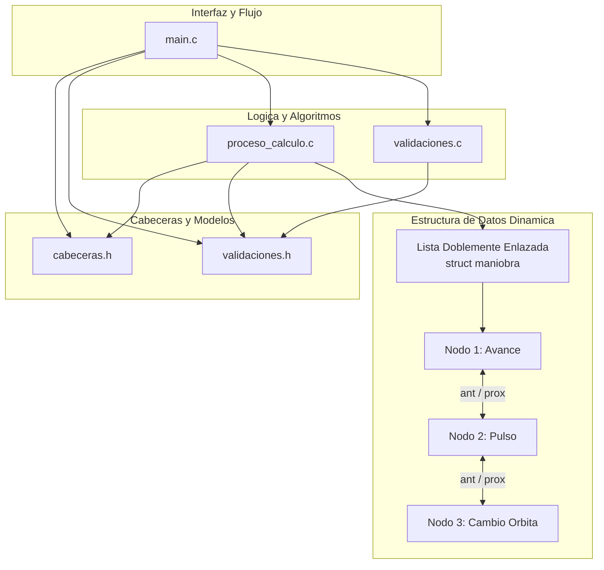

# Simulador Artemis - Inserción y Estabilidad en Órbita Terrestre Baja (LEO)

Trabajo Práctico Integrador Final de **Algoritmos y Estructuras de Datos**  
Universidad Tecnológica Nacional - Facultad Regional Resistencia  
Ingeniería en Sistemas de Información

---

## 1. Integrantes y Comisión

| Nombre y Apellido | Legajo | Usuario de GitHub |
|---|---|---|
| Silva, Isaias Eleazar | 31325 | isaiasezsilva-cloud |
| Ruben, Adan Ledesma | 31224 | Adan4321 |
| Viera, Tomás Gonzalez | 31556 | Tomasberg |
| Collazo, Raul | 28137 | RaulCollazo |
| Echavarria, Ithan Xavier | 31108 | StephenWolfCode |

**Comisión:** K1.2  
**Repositorio:** (https://github.com/Adan4321/laboratorio_c)

---

## 2. Escenario Artemis Asignado

**Situación - Problema 2: Inserción y Estabilidad en Órbita Terrestre Baja — LEO (MCU y Gravitación).**

Tras apagar sus motores de ascenso, la nave Orion es inyectada en una órbita terrestre baja (LEO) de estacionamiento, donde realiza un Movimiento Circular Uniforme (MCU) a una altitud de $h = 192\text{ km}$ ($192.000\text{ m}$) sobre la superficie terrestre.

### Constantes y Datos Físicos del Escenario

| Parámetro | Símbolo | Valor | Unidad |
|---|:---:|:---:|:---:|
| Constante de Gravitación Universal | $G$ | $6,674 \times 10^{-11}$ | $\text{N}\cdot\text{m}^2/\text{kg}^2$ |
| Masa de la Tierra | $M_T$ | $5,972 \times 10^{24}$ | $\text{kg}$ |
| Producto gravitacional estándar | $\mu = G \cdot M_T$ | $3,9857128 \times 10^{14}$ | $\text{m}^3/\text{s}^2$ |
| Radio medio de la Tierra | $R_T$ | $6.371.000,0$ | $\text{m}$ |
| Altitud orbital inicial de referencia | $h$ | $192.000,0$ | $\text{m}$ |
| Radio orbital total inicial | $r = R_T + h$ | $6.563.000,0$ | $\text{m}$ |
| Masa de la nave Orion | $m_{orion}$ | $33.000,0$ | $\text{kg}$ |

### Modelo Físico y Fórmulas Empleadas

* **Radio Orbital:** $r = R_T + h$
* **Velocidad Orbital (MCU):** Igualando la fuerza gravitatoria a la centrípeta ($F_g = F_c$):
  $$v = \sqrt{\frac{G \cdot M_T}{r}}$$
* **Período Orbital:** $T = \frac{2\pi r}{v}$
* **Velocidad Angular:** $\omega = \frac{v}{r}$
* **Aceleración Centrípeta:** $a_c = \frac{v^2}{r} = \frac{G \cdot M_T}{r^2}$
* **Fuerza Gravitatoria / Centrípeta:** $F_g = m_{orion} \cdot a_c$
* **Vueltas por Día:** $V_{dia} = \frac{86.400}{T}$
* **Pulso Lateral Auxiliar:** Con aceleración lateral $a$ durante lapso $\Delta t$:
  * Velocidad lateral adquirida: $v_{lat} = a \cdot \Delta t$
  * Desviación lateral instantánea: $\Delta x_{lat} = \frac{1}{2} a (\Delta t)^2$
  * Velocidad neta resultante: $v_{res} = \sqrt{v^2 + v_{lat}^2}$
* **Maniobras de Cambio de Órbita:** Modelado en dos fases con aceleración y desaceleración constante ($a = \frac{4 \cdot \Delta r}{T^2}$), registrando la cinemática discretizada en arreglos de posición y velocidad.

### Valores de Referencia del Escenario ($h = 192\text{ km}$, $m = 33.000\text{ kg}$)

* **Velocidad orbital:** $\approx 7.792,95\text{ m/s}$ ($28.054,6\text{ km/h}$)
* **Período orbital:** $\approx 5.291,52\text{ s}$ ($88,19\text{ min}$)
* **Aceleración centrípeta:** $\approx 9,2534\text{ m/s}^2$ ($0,944\text{ g}$)
* **Fuerza gravitatoria:** $\approx 305.362,10\text{ N}$
* **Pulso lateral ($a = 0,50\text{ m/s}^2$, $\Delta t = 10,0\text{ s}$):** $v_{lat} = 5,00\text{ m/s}$, desvío $\Delta x = 25,00\text{ m}$.

---

## 3. Reglas y Dinámica del Simulador

El sistema opera mediante un bucle interactivo por consola con un menú estructurado en 8 opciones:

```text
=================================
      SIMULADOR ARTEMIS
=================================
1- Emular Ángulo Desplazado
2- Avanzar durante un lapso de tiempo
3- Cambiar Órbita
4- Ejercer Pulso Lateral
5- Panel de Estado
6- Calcular fuerza centrípeta (demostración)
7- Ver Reporte
8- Salir
---------------------------------
```

1. **Emular Ángulo Desplazado:** Permite calcular el ángulo recorrido a partir de un tiempo ingresado o, inversamente, determinar el tiempo requerido para cubrir determinado ángulo o fracción de órbita.
2. **Avanzar durante un lapso de tiempo:** Simula el avance orbital en el tiempo. Cada avance se registra como un nuevo nodo en la lista dinámica.
3. **Cambiar Órbita:** Permite ascender o descender a una nueva altitud dentro de los márgenes seguros ($160\text{ km}$ a $2.000\text{ km}$), simulando las fases de aceleración y frenado y actualizando el estado de la nave.
4. **Ejercer Pulso Lateral:** Aplica un empuje perpendicular a la trayectoria orbital, evaluando la velocidad lateral, desvío y vector de velocidad resultante.
5. **Panel de Estado:** Muestra los parámetros físicos actuales de la cápsula (radio, altura, velocidad, período orbital, aceleración centrípeta y revoluciones diarias).
6. **Demostración de Fuerza Centrípeta:** Demuestra analítica y numéricamente la igualdad entre la atracción gravitatoria newtoniana y la fuerza centrípeta que mantiene a Orion en órbita circular estable.
7. **Ver Reporte (Estructura Dinámica):** Submenú analítico que explora el historial de maniobras almacenadas en la lista doblemente enlazada:
   * Listado cronológico (hacia adelante).
   * Listado inverso (del más reciente al más antiguo).
   * Búsqueda detallada de maniobra por ID.
   * Promedios de desplazamiento y tiempo (sobre las últimas $N$ maniobras o sobre el total).
   * Máximos y mínimos en un rango configurable de IDs (velocidades extremas, mayor aceleración, mayor desplazamiento, etc.).
   * Estadísticas acumuladas agrupadas por tipo de maniobra.
8. **Salir:** Libera de manera segura toda la memoria dinámica asignada a la lista y finaliza la ejecución.

---

## 4. Arquitectura del Software y Estructuras de Datos

### Organización Modular del Proyecto

| Archivo | Responsabilidad Técnica |
|---|---|
| `main.c` | Función principal `main()`, control del menú interactivo y ciclo de vida de la simulación. |
| `cabeceras.h` | Definición de constantes físicas y operativas, tipos estructurados (`maniobra`, `artemis`) y prototipos de funciones. |
| `proceso_calculo.c` | Implementación de las funciones de física orbital, manipulación de la lista doblemente enlazada, discretización cinemática y reportes. |
| `validaciones.h` / `.c` | Funciones de entrada robusta (`leer_entero`, `leer_double`), limpieza de pantalla (`limpiar_pantalla`) y pausas de lectura (`pausar_pantalla`). |
| `Makefile` | Script estándar de construcción para compilar el proyecto con GCC en entornos tipo Unix o MinGW. |
| `.vscode/` | Configuración para compilación y depuración con un solo clic (`tasks.json` y `launch.json`). |

### Diagrama de Arquitectura (Mermaid)



### Estructura de Datos: Lista Doblemente Enlazada

Para registrar el historial de maniobras sin imponer límites estáticos artificiales, se implementó una **lista doblemente enlazada dinámica**:

```c
typedef struct maniobra {
    int id;
    int tipo;                 // TIPO_AVANCE, TIPO_ORBITA o TIPO_PULSO
    double desplazamiento;
    double tiempo;
    double aceleracion;
    double v_maniobra_max;
    double v_orbital_final;
    double radio_final;
    double altura_final;
    struct maniobra *prox;    
    struct maniobra *ant;     
} maniobra;
```

**Ventajas Clave :**
* **Inserción en $O(1)$:** El puntero de cola `ult` permite incorporar maniobras al final de la lista sin recorrerla.
* **Navegación bidireccional:** Permite auditar el historial en orden cronológico (`prox`) o del más reciente al más antiguo (`ant`).
* **Búsquedas y rangos:** Facilita filtrar subconjuntos de maniobras para calcular promedios, cotas máximas y mínimas sin desperdiciar memoria.
* **Gestión de memoria:** Uso estricto de `malloc()` para cada nodo y función `liberar_lista()` para evitar fugas de memoria al terminar o reiniciar.

Adicionalmente, se utilizan arreglos (`pos[MAX_PASOS]`, `vel[MAX_PASOS]`) dentro de `proceso_calculo.c` para emular paso a paso la cinemática de aceleración y frenado durante las maniobras de cambio de órbita.

---

## 5. Compilación y Ejecución

El proyecto está preparado para ejecutarse mediante `make` o mediante comandos de terminal.

### Opción 1: Ejecución en VS CODE 

1. Abrir la carpeta del proyecto en VS Code (`Archivo > Abrir carpeta...` seleccionando la carpeta `laboratorio c`).
2. Abrir cualquier archivo (por ejemplo `main.c`).
3. **Presionar la tecla `F5`** o hacer clic en el botón de **Play (▶)** ubicado en la esquina superior derecha del editor.
4. Si VS Code solicita seleccionar la configuración, elegir **`Ejecutar Artemis`** o **`(gdb) Iniciar`**.
5. El proyecto se compilará automáticamente en su totalidad y se abrirá una ventana de consola externa con el simulador listo para usar.

### Opción 2: Compilación con Makefile

Si se dispone de `make` o `mingw32-make`:

```bash
# Compilar todo el proyecto
make

# Ejecutar el simulador
./artemis.exe

# Limpiar archivos compilados (.o y .exe)
make clean
```

### Opción 3: Compilación manual con GCC

```bash
gcc -Wall -Wextra -g main.c proceso_calculo.c validaciones.c -o artemis.exe -lm
./artemis.exe
```

---
## 7. Registro de Uso de Inteligencia Artificial

| Herramienta | Tareas Específicas Realizadas |
|---|---|
| Asistente IA (Antigravity CLI / Gemini) | - Asistencia en la estructuración, formato Markdown y redacción técnica de la documentación formal (`README.md`).<br>- Asistencia en la confección del diagrama de arquitectura en sintaxis Mermaid.<br>- Generación inicial del archivo `Makefile` y configuración de tareas de compilación/depuración de VS Code (`tasks.json` y `launch.json`).<br>- Detección y corrección de advertencias del compilador GCC al enlazar `-lm`. |

### Prompts y Consultas Representativas

1. *"Cómo estructuro un Makefile en C que compile main.c, proceso_calculo.c y validaciones.c con -Wall -Wextra y la librería -lm?"*
2. *"Configurá tasks.json y launch.json de VS Code para que al tocar Play o F5 compile los tres archivos y lance artemis.exe en la consola."*
3. *"Generá la documentación técnica del proyecto en README.md siguiendo la rúbrica del TPI de Algoritmos y Estructuras de Datos, detallando el escenario 2 (LEO) y la lista doblemente enlazada con diagrama Mermaid."*

---

## 6. Validaciones y Control de Errores

Para garantizar la estabilidad del simulador frente a ingresos inesperados del usuario:

* **Lectura protegida:** Se descartan caracteres no numéricos y entradas mal formadas en el buffer de `stdin`.
* **Control de rangos:** Validación de cotas mínimas y máximas en cada menú y parámetro físico (ej. altitudes entre $160\text{ km}$ y $2.000\text{ km}$).
* **Interfaz de consola limpia:** 
  * La pantalla se limpia automáticamente (`limpiar_pantalla`) ante cualquier ingreso erróneo antes de volver a solicitar el dato, evitando la acumulación de texto repetitivo.
  * Se implementaron pausas interactivas (`pausar_pantalla`) tras cada resultado para permitir una lectura pausada antes de regresar al menú principal.
  * Salida configurada en `UTF-8` en Windows mediante `SetConsoleOutputCP(CP_UTF8)` para la correcta visualización de caracteres en español y símbolos matemáticos.

---


